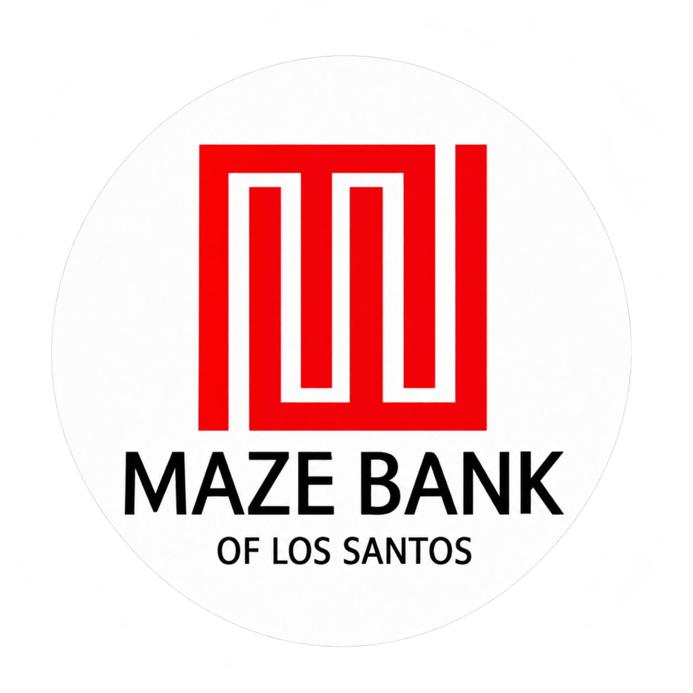

# 贡献者

- [ADsurfboard](https://github.com/ADsurfboard)：项目作者、产品设计、测试与维护。模组夹及其命名、着色与卡片交互由作者提出。

## 开发者与平台分工

**[时咨月.](https://github.com/shiziyueyuan) · Windows 版本授权开发者、移植负责人**

经项目作者 ADsurfboard 正式授权，负责后续 Windows 版本的移植开发、兼容性适配、测试与维护。Windows 工作在本仓库的 [`windows`](https://github.com/ADsurfboard/MC-Harbor/tree/windows) 分支进行。

macOS、iOS 及除 Windows 外的版本继续由 ADsurfboard 独立开发与维护。此处记录正式开发职责，Windows 移植进度以该分支的实际提交和验证为准；不将职责委任写作已经完成的代码贡献。详细分工见 [GOVERNANCE.md](GOVERNANCE.md)。

## 社区贡献者

**jiekee❄**

问题反馈与复现：提供 Intel 与不同 macOS 版本下的加载器下载超时、实例删除、程序坞窗口恢复、模组列表遮挡、游戏运行时资源下载受阻、翻页汉化失效及快捷方式误开浏览器和未启动游戏的线索。

功能与交互建议：提出外置认证、模组推荐、中英文搜索、简介及语言文件汉化、实例快捷方式、关闭游戏、拖入整合包、按内容导出及实例资源批量管理；补充国内来源、搜索和授权体验方面的反馈。

**花圆银行**

导入进度展示建议：提出整合包导入时展示当前处理阶段与下载进度，替代仅显示加载转圈，让玩家了解任务状态并判断是否停滞。

经确认的问题反馈、修复、文档和功能贡献将保留公开署名。测试好友不计入真实贡献者。

### 时咨月.

承担官方 Windows 移植方向的后续开发职责。具体修复、功能与发布贡献会按实际完成情况补充；其署名与现有 macOS、iOS 版本作者身份分别记录。
