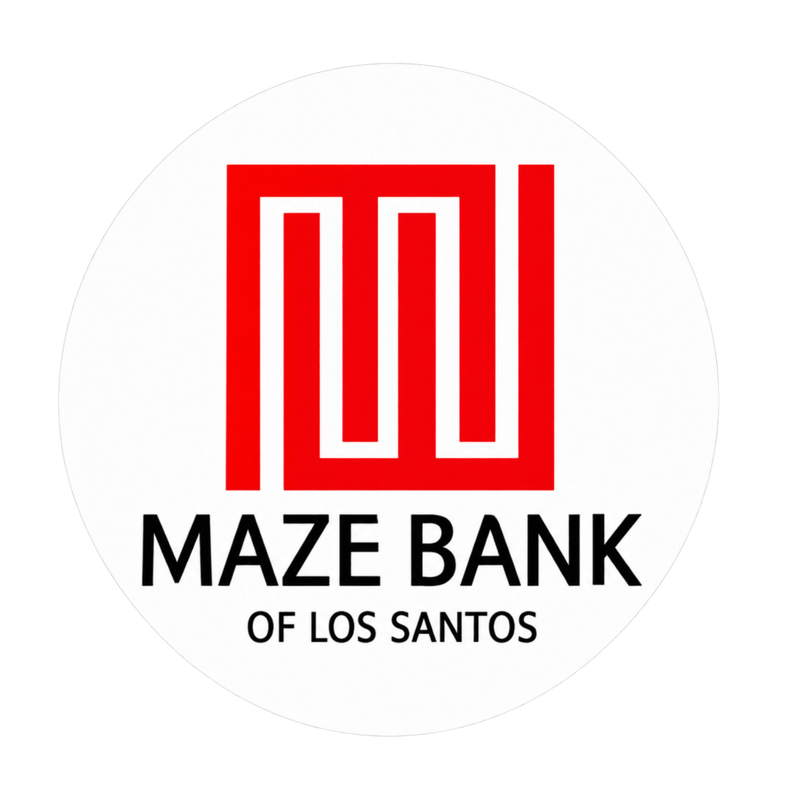

# 贡献者

## 作者与维护负责人 · [ADsurfboard](https://github.com/ADsurfboard)

项目作者、产品设计、测试与维护。模组夹及其命名、着色与卡片交互由作者提出。

## 开发者与平台分工

**[时咨月.](https://github.com/shiziyueyuan) · Windows、Android 与 Linux 移植负责人**

经 ADsurfboard 授权，负责 Windows、Android 与 Linux 的移植开发、兼容性适配、测试与维护。Windows 移植在本仓库的 [windows 分支](https://github.com/ADsurfboard/MC-Harbor/tree/windows)推进。macOS 与 iOS / iPadOS 继续由 ADsurfboard 独立开发与维护。

## 社区贡献者

**jiekee❄**

问题反馈与复现：提供 Intel 与不同 macOS 版本下的加载器下载超时、实例删除、程序坞窗口恢复、模组列表遮挡、游戏运行时资源下载受阻、翻页汉化失效及快捷方式误开浏览器和未启动游戏的线索。

功能与交互建议：提出外置认证、模组推荐、中英文搜索、简介及语言文件汉化、实例快捷方式、关闭游戏、拖入整合包、按内容导出及实例资源批量管理；补充国内来源、搜索和授权体验方面的反馈。

**花圆银行**

导入进度展示建议：提出整合包导入时展示当前处理阶段与下载进度，替代仅显示加载转圈，让玩家了解任务状态并判断是否停滞。

经确认的问题反馈、修复、文档和功能贡献将保留公开署名。测试好友不计入真实贡献者。
