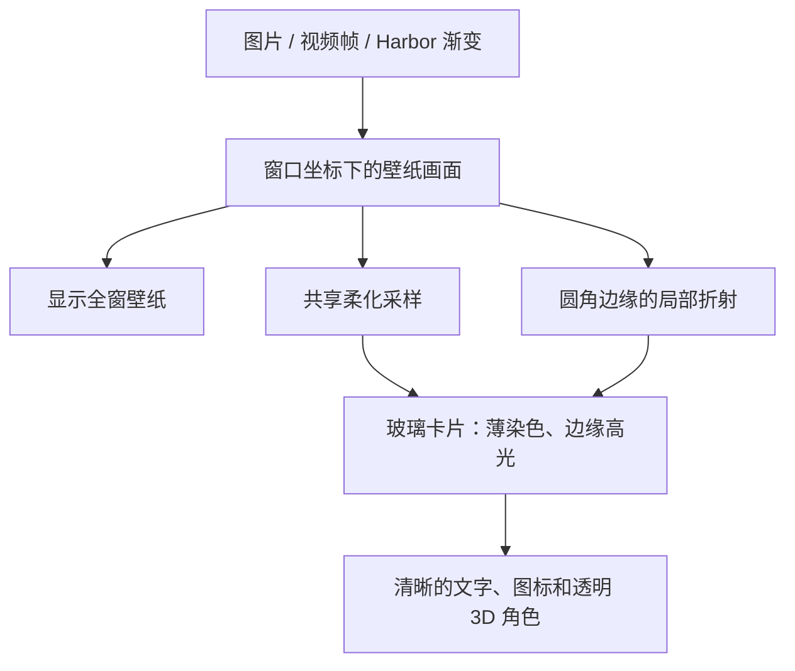

# MC Harbor Windows x64 视觉还原计划

## 1. 还原目标

以本次 1280 × 747 参考图中的 macOS 账号页为首个验收场景。窗口左上角使用应用内绘制的红、黄、绿三个圆形窗口按钮。壁纸连续铺过侧栏和内容区，侧栏、账号列表与皮肤详情各自形成独立的玻璃面，卡片之间能看见壁纸。账号头像、文字和 3D 角色保持清晰。账号页确认后，同一套材质用于游戏、下载、模组夹、联机、好友和设置页。

参考图给出了构图和静态材质的目标。原版支持应用内壁纸，也能透出 macOS 窗口后景。截图中的街景来源和是否为视频需要用原素材确认。使用同一场景对拍时，将同源图片或视频作为 Windows 应用内壁纸，记录裁切方式、视频时间点、对应的皮肤 PNG 和原版外观设置。可先用固定的本地壁纸和离线测试皮肤校准布局与模型比例。截图坐标均为近似读数。 [原版壁纸层](../Sources/WallpaperView.swift#L23) · [原版窗口后景](../Sources/WallpaperView.swift#L138)

本地 macOS 参考基线为 Windows 移植分支的 Swift 源码（`a9b242c`）。原版 `HarborMaterial` 按通透度混合窗口内的扩散层与 SwiftUI Liquid Glass，再叠中性薄膜和描边。游戏封面中的三块投影叠片属于独立装饰，账号页沿用单张圆角玻璃卡片。Windows 采用自身的 GPU 合成实现，以两端画面和交互验收。 [原版窗口与三块叠片](../Sources/LauncherViews.swift#L139) · [原版材质](../Sources/HarborTheme.swift#L71) · [Apple Glass](https://developer.apple.com/documentation/swiftui/glass)

## 2. 截图布局基准

坐标原点为参考图左上角。Windows 在 100% 缩放、1280 × 747 客户区使用下表的尺寸起点，再随 DPI 和可用宽度调整。SwiftUI 源码中的 pt 用于校验比例，WinUI 用 DIP 排版，以截图中的位置校准。

| 部位 | 参考图中的位置或尺寸 | Windows 实现 |
| --- | --- | --- |
| 窗口按钮 | 左上红、黄、绿三圆，直径约 12 px，圆心约为 (14, 14)、(34, 14)、(54, 14) | 放在应用内顶部，按 12 DIP 直径和 20 DIP 中心间距起步。三个圆点分别是关闭、最小化、最大化／还原。 |
| 侧栏 | 宽约 184 px，贯穿窗口。品牌在左上，选中行约 155 × 41 px，账号卡贴左下 | 侧栏起步宽 184 DIP，内边距约 14 DIP。用原透明折叠 h 标志、字标和左对齐图文菜单。选中行套 14 DIP 圆角玻璃。底部账号卡显示当前像素头像和账号类型。 |
| 顶部 | 小页名从 x≈207 起。大标题在 x≈207、y≈105。右侧有刷新和账号操作 | 顶栏放小页名和刷新，空白处可拖拽窗口。主区左右间距从 24 DIP 开始，标题约 30 DIP。皮肤库与 HMCL 导入按钮右对齐，Mac 迁移包放入导入菜单。 |
| 账号列表 | 卡片约 x=207–416、y≈155 起，双账号样例高度约 147 px | 左列约 210 DIP，外卡圆角约 21 DIP。账号行放约 35 DIP 像素头像、名称和账号类型，选中行用浅色叠层加勾选标记。长名单使用可滚动列表。 |
| 皮肤详情 | 卡片约 x=435–1241、y=155–692。两卡相距约 19 px，顶边对齐。角色可见高度约 239 px | 右列用剩余宽度，间隙约 19 DIP，圆角约 23 DIP，内边距约 21 DIP。左上是约 24 DIP 的账号名，右上是刷新与更多。预览区高约 293 DIP，角色水平居中。 |
| 底部操作 | 卡片内有姿态、模型和导入控件。登录按钮在两列下方 | 姿态做「静止／旋转／行走」分段按钮，模型做「标准／纤细」。页面底行依次放 Microsoft 登录、离线账号、外置登录，随页面滚动可达。 |

侧栏的图标使用固定宽度的左列，七个中文标签使用同一文字列。按钮支持 Tab、方向键和读屏。资源市场归入下载，实例资源与汉化从游戏界面进入。内容区可用宽度低于约 680 DIP 时，账号列表与详情上下排布。 [原版账号页](../Sources/AccountCenter.swift#L16) · [原版侧栏](../Sources/LauncherViews.swift#L92) · [Windows 导航](../windows/MainWindow.Navigation.cs)

导航和页面操作图标沿用随包分发的 Fluent System Icons，按截图中的图标用途、尺寸和线宽选字形，品牌用原项目的透明标志资源。 [透明标志来源](../tools/RenderBrand.swift) · [Fluent System Icons](https://github.com/microsoft/fluentui-system-icons)

### 应用内窗口按钮

使用 `OverlappedPresenter.SetBorderAndTitleBar(true, false)` 隐藏 Windows 标题栏及系统按钮，保留可调整尺寸的窗口边框。壁纸铺到窗口内顶部，三枚圆钮叠在左上角，右上留给页面刷新。用 WinUI 的 `Button` 模板绘制圆形外观，每枚按钮有独立且比圆点大的点击区域。常态只显示色点，移入按钮组或键盘聚焦时显示功能符号，失焦时降低亮度。高对比度下使用系统颜色与可辨识符号。按钮提供中文提示和读屏名称。 [Microsoft 窗口管理](https://learn.microsoft.com/en-us/windows/apps/develop/ui/manage-app-windows#overlappedpresenter) · [Microsoft 按钮辅助功能](https://learn.microsoft.com/en-us/windows/apps/develop/ui/controls/buttons#accessibility)

| 按钮 | 操作 |
| --- | --- |
| 红色 | 进入与 Alt+F4 共用的关闭请求。遇到实例文件写入或 Minecraft 正在运行时，沿用等待提示或保存后退出的确认流程。 |
| 黄色 | 最小化到 Windows 任务栏，支持从任务栏和已有单实例激活入口恢复。 |
| 绿色 | 最大化到当前屏幕的工作区，再点还原到原位置与尺寸。同步更新功能符号和提示。 |

顶部空白区可拖动，双击可切换最大化与还原。自绘窗口通过 `WM_NCCALCSIZE` 让应用内容覆盖系统框架区域，通过 `WM_NCHITTEST` 保留拖拽和边缘缩放。Windows 11 关闭系统边框的着色。最大化仍使用当前屏幕工作区。 [窗口框架实现](../windows/Services/HarborWindowFrame.cs) · [Windows 客户区说明](https://learn.microsoft.com/en-us/windows/win32/winmsg/wm-nccalcsize)

## 3. 背景和玻璃渲染

Windows 使用不透明的底图承载壁纸。侧栏和主区使用同一片中性灰玻璃，中间只有一条淡边。各页主要卡片按其在窗口中的位置采样底图，并叠加模糊、折射、高光和阴影。 [布局](../windows/MainWindow.xaml) · [玻璃卡片](../windows/Controls/HarborGlassCard.cs)

1. **统一壁纸输入。** 图片按比例填充窗口。视频由同一个 `MediaPlayer` 静音循环，使用帧服务的 `VideoFrameAvailable` 和 `CopyFrameToVideoSurface` 把最新帧送入可采样的 Direct3D 表面，再由 Win2D／Composition 显示。图片和视频使用同一裁切、调暗和柔化逻辑。复用现有壁纸库、导入和当前选择。无壁纸时显示原版风格的 Harbor 渐变。直放的 `MediaPlayerElement` 属于 WinUI 外部内容，合成画刷取得的是它所在区域的透明背景。帧服务路径让同一视频帧既能铺满背景，也能被卡片采样。 [现有壁纸加载](../windows/MainWindow.Appearance.cs#L300) · [原版壁纸](../Sources/WallpaperView.swift#L23) · [Microsoft 合成限制](https://learn.microsoft.com/en-us/windows/apps/develop/composition/visual-layer#external-content) · [Microsoft 视频帧服务](https://learn.microsoft.com/en-us/windows/apps/develop/media-playback/play-audio-and-video-with-mediaplayer#use-mediaplayer-in-frame-server-mode)
2. **恢复背景、染色、高光的层次。** 每块玻璃从同一张底图采样，使用自己的高斯模糊半径，按通透度与清晰壁纸混合。圆角外沿使用细描边，卡片内侧叠染色、定向高光和下缘暗部。 [原版材质配置](../Sources/HarborTheme.swift#L71) · [Windows 材质与配色](../windows/MainWindow.HarborVisuals.cs)
3. **加入圆角边缘折射。** 位移图编码圆角的外法线，Win2D `DisplacementMapEffect` 按该方向重采样底图，Alpha 蒙版只保留窄边缘。悬停或按下会加深当前卡片的折射。 [位移渲染](../windows/Services/GlassRefractionSurface.cs) · [Direct2D 位移](https://learn.microsoft.com/en-us/windows/win32/direct2d/displacement-map)
4. **继承外观设置。** 「设置 → 外观」提供玻璃通透度、阴影强度、全局与分区模糊半径。通透度默认 40%，阴影强度默认 24%，可调到 0%。侧栏、账号列表和详情卡在单独调整前跟随全局模糊值。「恢复玻璃默认值」清除对这些参数的单独设置。

GPU 路径共用设备与可互操作的纹理。静图在切换素材、缩放或调整外观时重算。视频背景更新上限为每秒 24 次，随帧更新的玻璃采样上限为每秒 12 次。窗口失焦、最小化、开启减少动态效果或游戏性能模式生效时，暂停视频和角色自动动画。渲染失败时保留主题底色，高对比度使用系统色。 [原版动效策略](../Sources/MotionPolicy.swift)

## 4. 内嵌透明 3D 皮肤

账号页和皮肤弹窗复用原生预览控件。C# 渲染器把角色绘制成带透明通道的图像，WinUI 将它叠在当前卡片或弹窗的底色上。旧版使用 `Opacity="0.01"` 隐藏 WebView2，控件仍可能在 WinUI 合成层留下矩形区域。 [预览控件](../windows/Controls/MinecraftSkinViewport.cs) · [WinUI 外部内容说明](https://learn.microsoft.com/en-us/windows/apps/develop/composition/visual-layer#external-content)

- 按 Minecraft 的 UV 布局绘制六个身体部位、外层服饰、披风和标准／纤细手臂，兼容 64 × 32 旧皮肤和 64 × 64 新皮肤。渲染使用深度测试、最近邻采样和预乘 Alpha，视场角 45°，默认绕竖轴约 20°。 [皮肤渲染器](../windows/Services/MinecraftSkinRenderer.cs) · [原版皮肤面板](../Sources/AccountCenter.swift#L107)
- 左侧头像从肤图合成脸部与帽子图层，按像素放大。进入账号页先显示缓存或默认头像，后台请求选中账号的皮肤。切换账号立即更新选中态，取消上一请求或忽略过期结果。皮肤请求和导入草稿按账号 ID 绑定，用户确认应用后复用现有更换接口。预览失败时以像素头像和简短状态填充卡片。 [原版头像裁切](../Sources/Skins.swift#L49) · [现有账号选中逻辑](../windows/MainWindow.xaml.cs#L740) · [现有皮肤业务接口](../windows/MainWindow.AccountFeatures.cs#L119)
- 默认静止。拖拽、键盘旋转、切换姿态和模型可触发重绘，自动旋转或行走仅在账号页可见且允许动画时更新。暂停时保留最后一个有效姿态。控件保留键盘焦点、可读名称与分段选中状态。

## 5. 实施顺序

| 阶段 | 改动 | 进入下一阶段的条件 |
| --- | --- | --- |
| 1. 锁定基线与合成通路 | 把参考图坐标、测试壁纸、预览姿态与预设外观记录下来。先在 Windows 10 22H2 x64 验证同一张图或视频帧能被玻璃采样，以及带 Alpha 的角色纹理能透出卡片。 | 三种层次可以稳定叠放，静图、视频和前景坐标一致。记录 Windows 11 x64 的对照结果。 |
| 2. 还原外壳和账号页 | 实现窗口内左上角三色按钮与拖拽区，再调整侧栏、账号列表、详情卡和底部登录操作。把选中态和账号行为接回现有入口。 | 左上角三枚圆钮的外观和操作通过第 6 节验收。以静止的同一款皮肤对照页面位置、透明区域、滚动与键盘操作。 |
| 3. 完成玻璃和动效 | 接入视频壁纸、边缘采样位移、按压、主题和外观控制，完善暂停、恢复和异常处理。 | 通过图片与 MP4 的材质对照、透明控制、减少动效和性能采样。 |
| 4. 推广到其他页面 | 游戏库先恢复原版主卡和三块叠片，再统一下载、模组夹、联机、好友、设置以及弹层的样式。 | 保留现有功能入口。各页使用一致的材质、焦点、字号和间距，完成缩放和高对比度回归。 |

涉及的现有文件主要是窗口布局、导航与外观、账号和皮肤业务。把共享玻璃样式、壁纸渲染和皮肤绘制从窗口代码中提取，供各页复用。 [窗口 XAML](../windows/MainWindow.xaml) · [主题与壁纸](../windows/MainWindow.Appearance.cs) · [账号与皮肤](../windows/MainWindow.AccountFeatures.cs)

## 6. 验收条件

| 检查 | 方法与通过条件 |
| --- | --- |
| 构图 | 固定客户区 1280 × 747 和截图缩放，记录壁纸裁切、时间点、账号数量、角色姿态和主题。用叠图核对左上三枚圆钮、侧栏边界、两张卡片的顶边、列间距、角色中心和底部按钮位置。首轮以关键边界相差约 4 px 以内为调校目标。 |
| 窗口按钮 | 在 Windows 10／11 检查可见的窗口控制只有左上角三色圆钮。覆盖点击、键盘与读屏、最小化后从任务栏恢复、最大化后还原、顶部拖动与双击、边缘缩放、跨屏、Alt+F4 和游戏运行时取消关闭。 |
| 材质 | 在同一张静图和一段本地 MP4 上检查壁纸贯穿侧栏与内容。使用直线或格线素材确认玻璃边缘只在圆角内偏折，卡片中心与外部保持连续。文字、头像和 3D 模型的边缘清晰。反复拖动通透和模糊滑杆，确认彼此独立并能保存重开。 |
| 皮肤 | 用两套离线测试资料验证快速切换账号、静止／旋转／行走、标准与纤细、64 × 32 旧皮肤、披风和 PNG 草稿预览。观察透明边界、窗口拉伸和滚轮滚动，确认失败时仍能选择账号和使用登录入口。 |
| 系统行为 | 在 Windows 10 22H2 x64 与 Windows 11 x64 上检查 100%、125%、150% 缩放及窄窗口。覆盖键盘导航、最小化恢复、跨屏切换、减少动态效果、系统关闭透明效果和高对比度。 |
| 开销 | 用同一游戏场景、图形设置和帧率上限测三轮 60 秒，分别比较静态基线、开启动效和游玩性能模式。记录游戏帧时间的 P95／P99，以及启动器 CPU、GPU 和内存变化。性能模式下以游戏 P95 帧时间相对静态基线增幅 ≤5% 为首轮目标。静态画面空闲时确认壁纸与皮肤没有持续请求重绘。 [PresentMon](https://github.com/GameTechDev/PresentMon) · [Microsoft GPUView](https://learn.microsoft.com/en-us/windows-hardware/drivers/display/using-gpuview) |

## 7. 当前实现状态

- 左上三色窗口按钮、折叠字标、侧栏、账号行和详情页按参考图布置。窄窗口中的账号卡改为上下排列，登录入口随页滚动。
- 壁纸、玻璃和 3D 角色由 WinUI 在窗口内合成。中性磨砂底图贯穿整个窗口，侧栏与主区之间保留一条淡边。主要卡片复用同一套玻璃效果，通透度和阴影可分别调节。
- 皮肤预览支持鼠标与方向键旋转、静止／旋转／行走、标准／纤细模型与 PNG 草稿。默认角色在本地读取，真实皮肤加载后更新头像和角色。
- 游戏库有三层封面叠片。游戏、下载、模组夹、联机、好友、设置，以及资源市场、实例资源和汉化入口均采用统一的磨砂卡片。
- Windows x64 构建和独立的角色图像检查通过。窗口构图、MP4 播放和不同缩放比例下的视觉表现仍待实机对照。截图背景需要在设置中导入同源壁纸。
